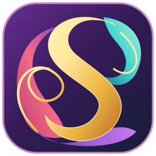

<p align="center">
  
</p>

<h1 align="center">Artilody Sampleforge</h1>

<p align="center">
  <b>Turn chromatic recordings into tuned SFZ instruments.</b><br>
  macOS &middot; Windows &middot; Debian / Ubuntu Linux
</p>

<p align="center">
  <a href="https://github.com/shenphenchoedron-hue/Artilody-Sampleforge/releases/latest"></a>
  <a href="https://github.com/shenphenchoedron-hue/Artilody-Sampleforge/actions/workflows/build.yml"></a>
  <a href="LICENSE"></a>
</p>

<p align="center"><a href="README-DA.md">Dansk version</a></p>

---

Record an instrument playing one note at a time in ascending chromatic order, load the file into Sampleforge, and get a ready-to-play **SFZ 1.0** instrument with **24-bit WAV** samples.

## Features

- **Automatic splitting** - detects every note onset and cuts the recording into individual samples.
- **Pitch detection** - YIN-based pitch measurement maps each sample to the correct key; missing notes become gaps instead of shifting the rest.
- **Fine-tuning** - per-sample correction suggestions in cents, A4 reference 400-480 Hz, original/corrected A/B preview, one-click approval of all reliable samples.
- **Editing** - trim boundaries, split at cursor, merge with next sample.
- **88-key overview** - fixed A0-C8 keyboard showing imported, selected and missing notes.
- **Open export format** - standard SFZ 1.0 + 24-bit PCM WAV, as a folder or ZIP. Works in sforzando, Sfizz, Decent Sampler and many DAW samplers.
- **Native and offline** - C++20 / JUCE, no browser engine, no network access needed.
- - **Works with Artilody Plugweaver** - making and correcting chromatic scale instrument recordings ready to be used in Artilody Plugweaver.

## Download

Get the latest version from the **[Releases page](https://github.com/shenphenchoedron-hue/Artilody-Sampleforge/releases/latest)**.

| System | File | Install |
|---|---|---|
| macOS 11+ (Apple Silicon & Intel) | `Artilody-Sampleforge-<version>-macOS.dmg` | Open the DMG and drag the app to Applications |
| Windows 10/11 x64 | `Artilody-Sampleforge-<version>-Windows-x64-Setup.exe` | Run the installer (English / Danish) |
| Windows 10/11 x64, portable | `Artilody-Sampleforge-<version>-Windows-x64-Portable.zip` | Unzip and run `Artilody Sampleforge.exe` |
| Debian 12+ / Ubuntu 22.04+ (amd64) | `artilody-sampleforge_<version>_amd64.deb` | `sudo apt install ./artilody-sampleforge_<version>_amd64.deb` |
| Other Linux x86_64 | `artilody-sampleforge-<version>-linux-x86_64.tar.gz` | Unpack and run `./artilody-sampleforge` |

> **First launch:** the builds are not signed with paid certificates.
> **macOS:** if the app is blocked, open *System Settings > Privacy & Security* and click **Open Anyway** (or run `xattr -dr com.apple.quarantine "/Applications/Artilody Sampleforge.app"`).
> **Windows:** on the SmartScreen warning, click **More info > Run anyway**.

## Manuals

- [User Manual (English, PDF)](docs/Artilody-Sampleforge-Manual-EN.pdf)
- [Brugermanual (Dansk, PDF)](docs/Artilody-Sampleforge-Manual-DA.pdf)

The manuals are also included in every installer and attached to each release.

## Quick start

1. Record notes one by one, ascending chromatically, with a short gap between them (WAV, AIFF or FLAC; up to about 6 minutes stereo).
2. **Import audio** - Sampleforge splits and analyses the recording.
3. Adjust **Floor dB** / **Spacing s** and click **Re-analyse** if notes are missed or over-detected. Fix the octave with **First note** or **Align range to this pitch**.
4. Select samples, listen with **Play** and **Corrected preview**, then **Apply tuning** or **Tune reliable samples**.
5. **Export... > SFZ + WAV folder** (or ZIP) and load `Instrument.sfz` in your SFZ sampler.

The export format is documented in [INSTRUMENT-FORMAT.md](INSTRUMENT-FORMAT.md). A short demo recording is included: [Demo-C4-B4-plus12cents.wav](Demo-C4-B4-plus12cents.wav).

## Building from source

Requires a C++20 compiler and CMake 3.24+. JUCE 8.0.4 is downloaded and verified automatically on the first build.

| System | Command | Prerequisites |
|---|---|---|
| macOS | `bash Build-Mac.command` | Xcode Command Line Tools |
| Windows | double-click `Build-Windows.bat` | Visual Studio 2022 / Build Tools with *Desktop development with C++*; optional Inno Setup 6 for the installer |
| Debian / Ubuntu | `bash Build-Linux.sh` | none - installs dependencies with apt and creates a `.deb` in `dist/` |

Manual build on any platform:

```sh
cmake -S . -B build -DCMAKE_BUILD_TYPE=Release -DBUILD_TESTING=ON
cmake --build build --config Release --parallel
ctest --test-dir build -C Release --output-on-failure
```

Linux build dependencies:

```sh
sudo apt install build-essential cmake pkg-config libasound2-dev libjack-jackd2-dev \
  libfreetype-dev libfontconfig1-dev libx11-dev libxcomposite-dev libxcursor-dev \
  libxext-dev libxinerama-dev libxrandr-dev libxrender-dev libgl1-mesa-dev
```

Releases are built by [GitHub Actions](.github/workflows/build.yml) for all three platforms whenever a `v*` tag is pushed. The PDF manuals are generated from `docs/manual/*.md` with `python3 docs/build-manuals.py` (needs `reportlab`).

### Project layout

| Path | Contents |
|---|---|
| `Source/Main.cpp` | JUCE window, layout, file dialogs, audio output, export |
| `Source/Dsp.h` | Onset detection, YIN pitch analysis, chromatic mapping, length-preserving pitch shift |
| `Source/Sfz.h` | SFZ mapping and WAV file naming |
| `Tests/dsp_test.cpp` | Self-test of the audio engine (run by CTest) |
| `packaging/` | DMG, Inno Setup and Debian packaging |
| `docs/` | Manuals (PDF and Markdown sources) |

## Limitations

Overlapping notes cannot be separated; noise, vibrato and very short notes can give uncertain pitch readings. The pitch shifter is a simple phase vocoder intended for small corrections. No SFZ import, project saving, loop editing, velocity layers or plug-in version yet.

## License

Artilody Sampleforge is free software under the [GNU General Public License v3](LICENSE).
It uses the [JUCE](https://juce.com) framework, which is licensed separately under AGPLv3 or the commercial JUCE licence - see [JUCE-LICENSE.md](JUCE-LICENSE.md).
